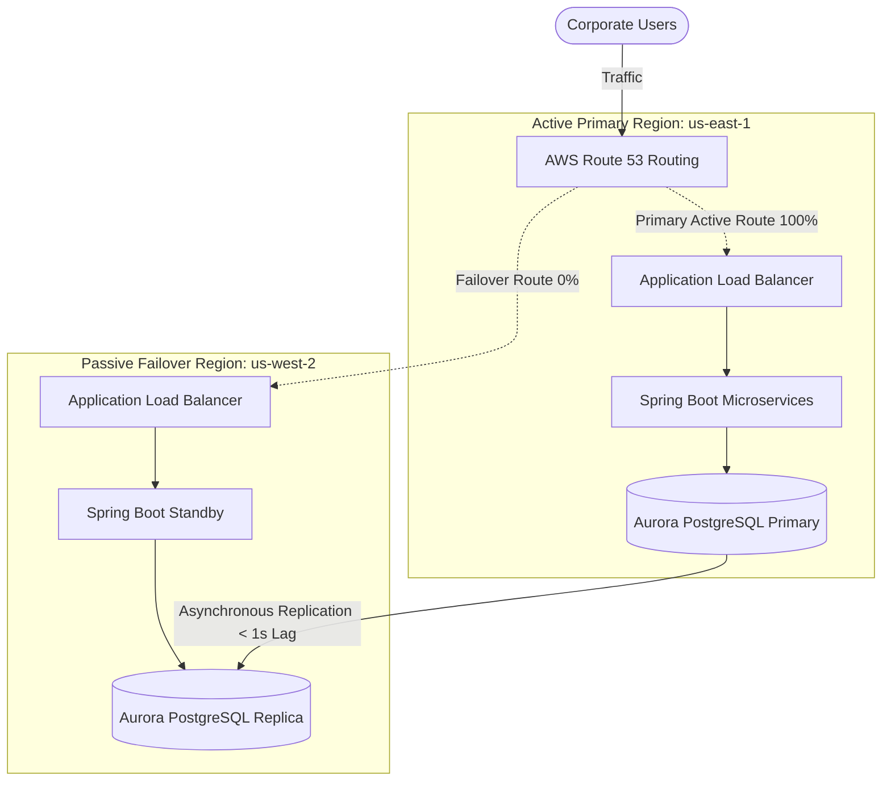

# AWS Multi-Region Disaster Recovery (DR) & Database Failover Loop

This document outlines the architecture for cross-region replication, failover loops, and data consistency management under network partition.

## 1. Disaster Recovery (DR) Strategy: Active-Passive (Pilot Light / Warm Standby)

For high-throughput enterprise databases (e.g., PostgreSQL/Aurora), an Active-Passive architecture with DNS-routed failover offers a strong balance of reliability and cost.

### Key Metrics
- **RTO (Recovery Time Objective)**: Target < 5 minutes. The time taken to detect failure, promote the passive DB, and shift DNS traffic.
- **RPO (Recovery Point Objective)**: Target < 1 second. The maximum amount of data (in seconds) that could be lost due to asynchronous replication lag.

---

## 2. Managing Database Replication Lag

In asynchronous replication (e.g., AWS Aurora Global Database), updates written to the Primary region take time (usually 50–200ms under normal loads, but up to seconds during network degradation) to arrive in the replica.

### Failure Scenarios & Mitigations

#### A. Read-After-Write Consistency Window (Read from Replica)
- **Problem**: A user updates their booking in the Primary region and is immediately redirected to a page that reads from the local read replica. If the replica lags, the user doesn't see their update.
- **Mitigation**: 
  - **Session Sticky Routing**: Route reads for a specific user to the Primary region for a "cooling window" (e.g., 2 seconds) after any write operation.
  - **Replication Lag Tracking**: Compare the client's write transaction ID or LSN (Log Sequence Number) against the replica's current LSN. If the replica is behind, route the read to the Primary DB.

#### B. Failover Promoted Database (RPO Loss Prevention)
- **Problem**: When Region A fails, the replica in Region B is promoted to Primary. Any transaction executed in Region A that was not replicated is lost.
- **Mitigation**:
  1. **Graceful Failover**: If Region A's compute is dead but the DB is healthy, initiate a coordinated switchover (Aurora Global Database promotes the replica with zero data loss).
  2. **Ungraceful/Uncoordinated Failover (Split-Brain Prevention)**:
     - Disconnect Region A's applications from the database before promoting Region B to prevent split-brain (two databases accepting writes independently).
     - Run post-failover reconciliation scripts by parsing transaction logs (WAL) from Region A once it recovers, matching them against Region B, and applying missing updates.

---

## 3. Route 53 DNS Failover Workflow

1. **Route 53 Active Health Checks** monitor the health of Region A's Application Load Balancer endpoint.
2. If health checks fail for 3 consecutive intervals (e.g., 30 seconds):
   - Route 53 shifts DNS routing to Region B's ALB.
   - An AWS Lambda function is triggered to promote the Aurora replica in us-west-2 to write-status.
   - Microservices in Region B reconnect to the newly promoted local master.
