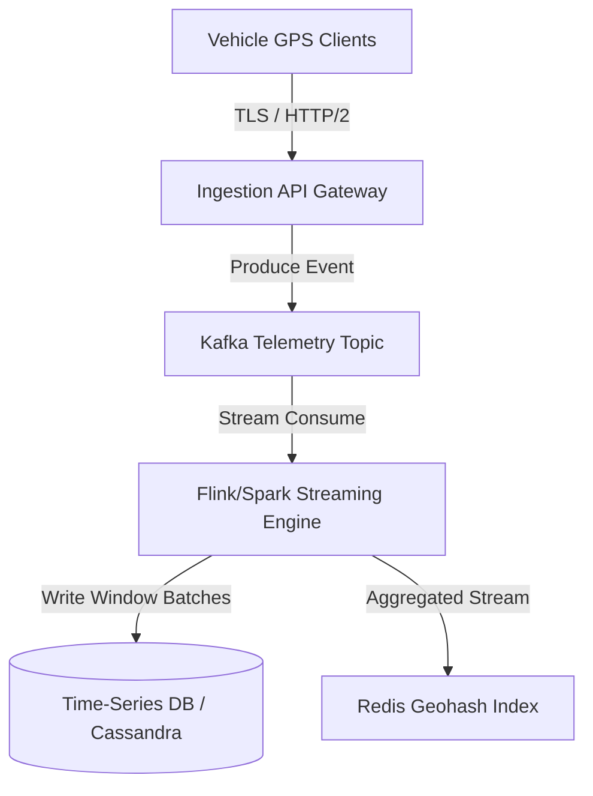
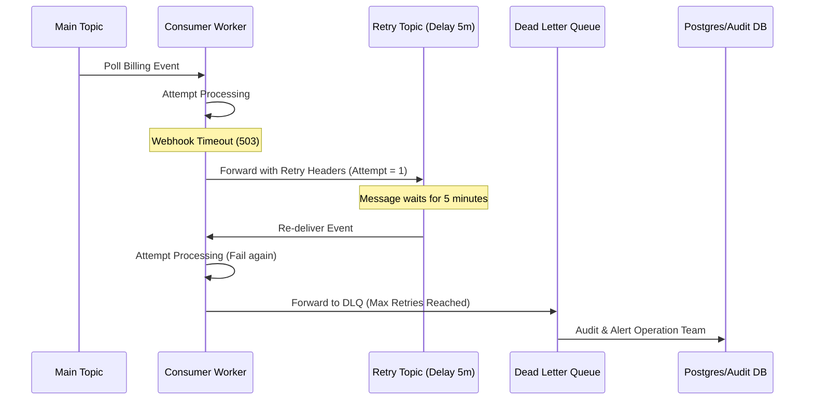

# High-Throughput Event Streaming: Kafka & Telemetry Strategy

This architecture design addresses the real-time processing of millions of employee telemetry points and robust transaction management under downstream dependency failures.

## 1. Telemetry Pipeline & Partition Strategy

To handle high-throughput GPS coordinates streaming from vehicles without overloading database logs, we decouple streaming ingestion from persistent storage.



### Partition Key Selection
- **Key**: `vehicle_id` (or `trip_id`). 
- **Rationale**: Ensures that all telemetry events for a specific vehicle are routed to the **same Kafka partition**. This guarantees chronological ordering of location updates, which is crucial for calculating velocity, route deviations, and geofence intersections.
- **Avoid Hotspots**: If one large corporate shuttle generates significantly more events, it won't overwhelm a partition because partitions are distributed across multiple brokers and we scale the partition count (e.g., 32 or 64 partitions) to balance the hashing distribution.

---

## 2. Horizontal Scaling & Consumer Lag Mitigation

When consumers experience lag, scaling consumer groups horizontally can trigger costly **Stop-the-World partition rebalances**, disrupting active streaming.

### Mitigations
1. **Incremental Cooperative Rebalancing**: Use Kafka's `CooperativeStickyAssignor` (default in newer versions). Instead of revoking all partition assignments and reassigning them, it only revokes the specific partitions moving between consumers, allowing unaffected consumers to keep processing.
2. **Decouple Polling from Processing (Worker Thread Pool)**:
   - Instead of running heavy processing on the main consumer thread, the consumer thread polls the events, submits them to an in-memory thread pool (e.g., `ThreadPoolExecutor`), and pauses/resumes partition consumption based on thread pool capacity to avoid buffer overflow.
   - This keeps the poll loop active, preventing Kafka from thinking the consumer is dead (thus avoiding `max.poll.interval.ms` timeouts and rebalances).

```
[Kafka Partition] ──(Poll)──► [Consumer Thread] ──(Enqueue)──► [Worker Thread Pool]
                                    ▲                                │
                                    └───────(Flow Control)───────────┘
```

---

## 3. Dead-Letter Queue (DLQ) & Webhook Failure Workflows

When a third-party API or billing webhook fails (e.g., network timeout), we isolate the message to prevent blocking the partition.



### Resiliency Configuration
- **Circuit Breaker**: Wrap the downstream webhook call in a **Resilience4j Circuit Breaker**. If failure rates exceed 50%, the circuit opens.
- **Fail-Fast**: While the circuit is OPEN, the consumer immediately routes incoming events to the Retry Topic or DLQ without making network calls, preventing endpoint flooding and local thread exhaustion.
- **Non-blocking Retries**: We create distinct retry topics based on backoff intervals (e.g., `billing-retry-5m`, `billing-retry-30m`) rather than pausing the consumer group.
